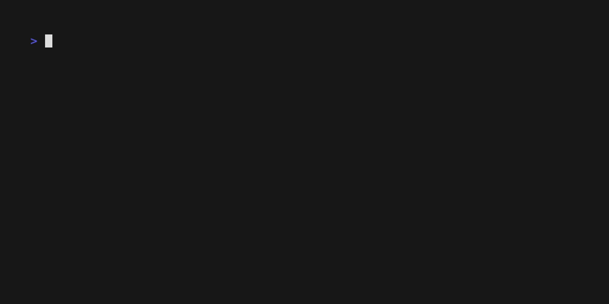

# goemberplusclient

[](https://github.com/lukirs95/goemberplusclient/actions/workflows/ci.yml)
[](https://github.com/lukirs95/goemberplusclient/releases/latest)
[](https://pkg.go.dev/github.com/lukirs95/goemberplusclient)

An [Ember+](https://github.com/Lawo/ember-plus) consumer (client) for Go.

Ember+ is a control protocol for broadcast equipment. A *provider* (usually a
device) offers a tree of nodes, parameters, matrices and functions; a
*consumer* (a control or monitoring system) browses and controls that tree.
This module implements the consumer side only. It has no dependencies outside
the standard library.

```
go get github.com/lukirs95/goemberplusclient
```

## Demo application that uses this library can be downloaded here



## Usage

```go
import emberplus "github.com/lukirs95/goemberplusclient"

c, err := emberplus.Dial(ctx, "192.168.1.10:9000")
if err != nil {
	return err
}
defer c.Close()

// Read a parameter. The client loads the parts of the tree it needs.
el, err := c.Get(ctx, "root/settings/info/version")

// Set a value. The result is the value the provider confirms.
v, err := c.SetValue(ctx, "root/dsp/gain", glow.Real(-3))

// Observe changes.
stop, err := c.Watch(ctx, "root/dsp/gain", func(e emberplus.Event) {
	fmt.Println(e.Element.(*glow.Parameter).Value)
})
defer stop()
```

The client offers:

| Method | Purpose |
|---|---|
| `GetDirectory` | request the children of a node, or a parameter, matrix or function itself |
| `Get`, `Children` | read from the mirrored tree, loading missing parts once |
| `IsOnline`, `IdentifierPath` | online state (with inheritance) and stable identifier path of an element |
| `SetValue` | change a parameter value |
| `Invoke` | call a function |
| `Connect` | change matrix crosspoints |
| `Watch` | receive changes of an element |
| `Subscribe` | start a stream parameter such as a level meter |

All methods are safe for concurrent use. See the
[package documentation](https://pkg.go.dev/github.com/lukirs95/goemberplusclient)
for details and examples.

### Paths

Elements are addressed by identifier paths (`"root/settings/info"`), numeric
paths (`"1.100.3"`) or a mix of both (`"root/100/info"`). The client resolves
every path itself. Numbers are only valid for one connection, so applications
should store identifier paths; `IdentifierPath` converts any path to that form.

Identifier paths are separated by `/` only. Identifiers may contain `.`, as in
`"dsp/gain.left"`.

### Watch and Subscribe

A provider reports changes of all elements below a node once its directory has
been loaded, and `Watch` takes care of loading it. Stream parameters, typically
audio level meters, only report values while they are subscribed and then send
updates every 50 to 80 ms. To avoid unintended traffic, `Watch` never
subscribes: call `Subscribe` explicitly. `glow.Parameter.IsStream` tells
whether a parameter is a stream; `Subscribe` refuses parameters that are not.

## Packages

| Package | Contents |
|---|---|
| [`emberplus`](https://pkg.go.dev/github.com/lukirs95/goemberplusclient) | the client |
| [`pkg/glow`](https://pkg.go.dev/github.com/lukirs95/goemberplusclient/pkg/glow) | the Glow data schema: elements, values, encoding and decoding |
| [`pkg/ber`](https://pkg.go.dev/github.com/lukirs95/goemberplusclient/pkg/ber) | the subset of ASN.1 BER used by Ember+ |
| [`pkg/s101`](https://pkg.go.dev/github.com/lukirs95/goemberplusclient/pkg/s101) | S101 framing, keep-alives and multi-packet messages |

The lower-level packages can be used on their own, for example to analyse
captured Ember+ traffic.

## emberplus-cli

`cmd/emberplus-cli` is a terminal browser built on the library. It shows the
provider tree, the details of the selected element and live values.

Download the archive for your platform from the
[releases](https://github.com/lukirs95/goemberplusclient/releases) and run:

```
emberplus-cli 192.168.1.10 9000    # or 192.168.1.10:9000
```

To build it from source, run `make build`; the binary is placed in `bin/`.

| Key | Action |
|---|---|
| `↑` `↓` / `k` `j` | move |
| `→` / `l` | open a node, or move to its first child |
| `e` / `Enter` | edit a parameter, invoke a function or show the crosspoints of a matrix (`Enter` opens nodes) |
| `←` / `h` | close a node, or move to its parent |
| `Space` | open or close a node |
| `g` `G`, `PgUp` `PgDn` | jump |
| `s` | subscribe to or unsubscribe from a stream parameter |
| `r` | reload the children of an open node |
| `q` | quit |

Editing depends on the parameter type: numbers, strings and octets are typed
in (with the displayed unit, range checked before sending), enums are chosen
from a list, booleans are toggled and triggers are fired after a confirmation.
Functions ask for each argument; functions without arguments ask for a
confirmation. The status line shows the value the provider confirmed or the
result of the invocation.

The crosspoint view of a matrix shows sources as rows and targets as columns,
with labels if the matrix reports them. `Enter` connects or disconnects the
selected crosspoint: matrices with one source per target replace the source,
N:N matrices add or remove it. `Esc` returns to the tree.

| Key | Action in the crosspoint view |
|---|---|
| `↑` `↓` `←` `→` / `k` `j` `h` `l` | move |
| `Space`, `PgDn`, `Ctrl+F` / `b`, `PgUp`, `Ctrl+B` | one page of sources down / up |
| `L`, `Shift+→` / `H`, `Shift+←` | one page of targets right / left |
| `g` / `G` | first / last source |
| `0` / `$` | first / last target |
| `Enter` | connect or disconnect |

The CLI is a separate Go module, so its dependencies
([Bubble Tea](https://github.com/charmbracelet/bubbletea) and
[Lip Gloss](https://github.com/charmbracelet/lipgloss)) are not added to
projects that use the library.

## Development

| Command | Purpose |
|---|---|
| `make test` | gofmt check, `go vet` and all tests with the race detector, for the library and the CLI |
| `make fuzz` | run the fuzz tests (`FUZZTIME=30s` by default) |
| `make build` | build `emberplus-cli` for this machine into `bin/` |
| `make dist` | build release archives for Linux, macOS and Windows (amd64 and arm64) into `dist/` |

GitHub Actions run `make test` and `make dist` for every push and pull
request. Pushing a tag such as `v0.1.0` creates a release with the archives.

## Compatibility

- Glow DTD up to 2.50, including matrices, functions, streams with stream
  descriptors and null values. Templates are skipped, which the specification
  allows for consumers.
- Both S101 variants are decoded; the client sends the escaping variant.
- Tested against a recorded session of a Lawo provider (a GP-I/O box with a
  matrix): the client sends the same requests as Lawo's own consumer and
  handles the provider's responses, including matrices whose connections
  arrive one per message. The recording is part of the tests
  (`pkg/glow/testdata`).
- Functions are implemented according to the specification but have not been
  tested against a device yet.

## Specification

Ember+ is specified by Lawo GmbH. The specification (`Ember+ Documentation.pdf`)
is published in the [ember-plus repository](https://github.com/Lawo/ember-plus/tree/master/documentation).
References such as `(spec: "Keep-Alive mechanism")` in the source code name its
chapters.

This project is an independent implementation. It is not affiliated with or
endorsed by Lawo GmbH.

## License

MIT, see [LICENSE](LICENSE).
